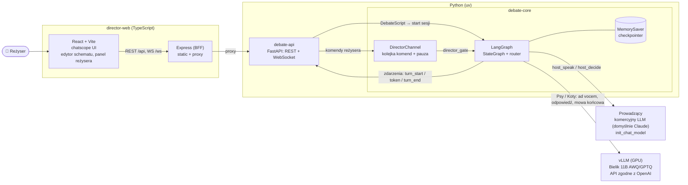
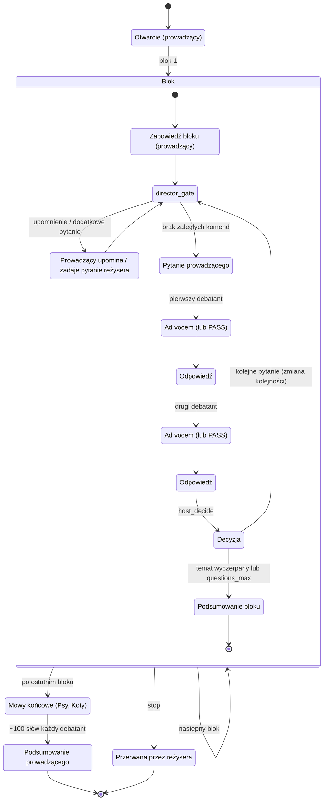

# ai-debate: plan

Symulacja debaty „psy vs koty”. Plik zawiera tylko **aktualne** ustalenia. Przy zmianie decyzji nadpisujemy treść bez zostawiania historii. Punkty odhaczamy w trakcie prac.

## Cel
- **Reżyser** to człowiek. Przez aplikację webową (Node/React), czyli swojego „agenta webowego”, ustala **schemat debaty**, a w trakcie wpływa na nią **wyłącznie przez prowadzącego**: prośba o upomnienie, dodatkowe pytanie, notatka.
- **Prowadzący** to komercyjny LLM z konfigurowalnym dostawcą, domyślnie Claude. Realizuje schemat, układa pytania i przekazuje interwencje reżysera.
- **Dwóch debatantów**, „Psy” i „Koty”, za którymi stoi lokalny Bielik serwowany przez vLLM (API zgodne z OpenAI).
- **Orkiestracja** przez LangGraph z ekosystemu LangChain: graf stanu, streaming, checkpointer.

## Wersje
- **v1 (ten plan)**: debatanci to pre-trenowany Bielik bez dodatkowej wiedzy. Argumentują tylko na podstawie tego, co model wie, i promptu strony.
- **v2 (kierunek, bez szczegółów)**: debatanci wzbogaceni o RAG z dokumentów naukowych o psach i kotach.
  - Zakres v2 to osobny plan.
  - W v1 zostawiamy tylko punkt zaczepienia: kontekst debatanta budowany jest w jednym miejscu (`build_debater_context` w `debate-core`). Później można tam dołożyć krok retrievalu bez zmiany grafu.

## Role (słownik)
Używamy wyłącznie tych nazw:
- **Reżyser**: człowiek w aplikacji `director-web`. W kodzie `director`.
- **Prowadzący**: agent LLM, który prowadzi debatę. W kodzie `host`.
- **Debatanci**: „Psy” i „Koty”. W kodzie `dogs` i `cats`.

## Diagramy

### Komponenty i przepływ komunikacji


### Maszyna stanów debaty (graf LangGraph)
Przed każdą wypowiedzią graf przechodzi przez `director_gate`: obsługuje pauzę i stop i wstawia zaległe upomnienia oraz dodatkowe pytania. Dla czytelności na diagramie bramka występuje tylko w pętli pytań.



## Ustalenia techniczne
- Część Python: Python ≥ 3.12 i uv workspace (`packages/*`), hatchling, `src/` layout, pytest w grupie `dev`.
- Część web: Node 26 (nvm) + pnpm 12 workspace, TypeScript, Express (serwer reżysera) + React + Vite (UI).
- Komponent czatu: `@chatscope/chat-ui-kit-react`, bez shadcn.
- Podział odpowiedzialności: Python (`debate-api`) uruchamia graf i wystawia REST + WebSocket. Express to BFF reżysera: serwuje zbudowany frontend i proxuje `/api` oraz `/ws` do `debate-api`. W trybie dev proxy robi Vite.
- Sekrety w `.env.local` (poza gitem), szablon w `.env.example`.
- Prowadzący: `init_chat_model(HOST_MODEL)`, np. `anthropic:claude-haiku-5-5`. Dostawcę zmienia się samą zmienną. Domyślnie instalowany jest tylko `langchain-anthropic`, pozostali dostawcy jako opcjonalne extras.
- Debatanci: `ChatOpenAI(base_url=DEBATER_BASE_URL, model=DEBATER_MODEL)`. Obaj korzystają z jednej instancji serwera i różnią się promptem systemowym. Opcjonalnie `DOGS_BASE_URL` / `CATS_BASE_URL` do rozdzielenia na osobne serwery.
- Bielik: `speakleash/Bielik-11B-v3.1-Instruct-AWQ` (W4A16 w formacie `compressed-tensors`, 6,2 GB) na Quadro RTX 5000 (16 GiB, Turing sm_75: bez BF16, FP8 i kerneli Marlin), `vllm serve ... --dtype half --max-model-len 16384 --max-num-seqs 4 --enable-prefix-caching`. vLLM (przypięta wersja) ma osobne środowisko `infra/vllm/` poza uv workspace, bo przypina własne torch. Jedna instancja obsługuje obie strony, a prefix caching ogranicza przeliczanie rosnącego kontekstu.
- Język debaty: polski.

## Schemat debaty (`DebateScript`)
Schemat ustala reżyser przed startem. To model Pydantic po stronie Pythona, z typem TS generowanym lub odwzorowanym w `director-web`.

```
DebateScript
  title: str
  blocks: list[Block]              # bloki tematyczne, w kolejności
    Block
      topic: str                   # np. „Więź emocjonalna człowiek–zwierzę”
      guidance: str | None         # opcjonalne wskazówki dla prowadzącego
      questions_target: int = 5    # „około 5”
      questions_min / questions_max: int = 4 / 6
  ad_vocem: AdVocem
    enabled: bool = True
    max_sentences: int = 3
  closing_statement:
    enabled: bool = True
    words: int = 100               # „około 100 słów”
  host_summary: bool = True   # podsumowanie prowadzącego na koniec (bez werdyktu)
```

Domyślny preset `psy-vs-koty` (plik JSON w `debate-core/presets/`):
1. Więź emocjonalna człowiek–zwierzę
2. Obowiązki człowieka wobec zwierzęcia
3. Koszty weterynaryjne

Każdy blok ma ~5 pytań, włączone ad vocem i mowy końcowe po ~100 słów.

## Przebieg debaty
1. **Otwarcie**: prowadzący wita, przedstawia temat, strony i plan bloków.
2. **Dla każdego bloku**:
   1. Prowadzący zapowiada blok.
   2. **Pytanie**: prowadzący układa kolejne pytanie, biorąc pod uwagę temat bloku, dotychczasowe odpowiedzi i to, czego jeszcze nie poruszono. Pytanie trafia do obu debatantów, a kolejność odpowiedzi zmienia się co pytanie.
   3. **Odpowiedź debatanta** to dwa kroki, czyli dwa osobne wywołania LLM, osobno streamowane i osobno pokazywane w UI:
      - *ad vocem* (opcjonalne, maks. N zdań) do ostatniej wypowiedzi przeciwnika. Debatant może je pominąć, odpowiadając tokenem `PASS`.
      - *odpowiedź* na pytanie.
   4. Po każdym pytaniu prowadzący decyduje (structured output: `{next_question | block_exhausted}`), czy temat jest wyczerpany. Liczba pytań mieści się w `questions_min..questions_max`, a domyślnie zbliża się do `questions_target`.
   5. Prowadzący krótko podsumowuje blok i przechodzi dalej.
3. **Mowy końcowe**: każdy debatant w ~100 słowach mówi, dlaczego pies / kot jest lepszy dla człowieka. Kolejność odwrotna niż w pierwszym pytaniu.
4. **Zamknięcie**: podsumowanie prowadzącego (jeśli `host_summary`).

Przepływ (fazy, bloki, liczniki, kolejność) jest **sterowany kodem** na podstawie schematu. LLM-y dostarczają treść i decyzję „temat wyczerpany”, ale nie sterują strukturą.

## Interwencje reżysera (zawsze przez prowadzącego)
Komendy trafiają do `DirectorChannel` i są realizowane w najbliższym punkcie kontrolnym, czyli przed kolejną wypowiedzią:
- `reprimand {target: dogs|cats, reason}`: prowadzący własnymi słowami upomina wskazanego debatanta (wiadomość widoczna w debacie). Upomnienie trafia też do kontekstu tego debatanta na kolejne tury.
- `extra_question {text, target: dogs|cats|both}`: prowadzący przeformułowuje pytanie reżysera i zadaje je jako następne. Nie wlicza się do limitu pytań bloku. Reżyser nigdy nie pisze bezpośrednio do debatanta.
- `note {text}`: dowolna instrukcja dla prowadzącego, np. „dociśnij koty o alergie”, uwzględniana przy kolejnych pytaniach.
- `pause` / `resume` / `stop`.

## Graf debaty (LangGraph)
Stan `DebateState`:
- `script: DebateScript`
- `phase: opening|block|closing_statements|closing|done`
- `block_idx`, `question_idx`, `current_question`, `answer_order`
- `transcript: list[Turn]`, gdzie `Turn` ma pola: speaker (`host|dogs|cats`), kind (`intro|block_intro|question|ad_vocem|answer|reprimand|block_summary|closing_statement|summary`), text, block_idx, passed (ad vocem pominięte przez `PASS`)
- `step`: następny krok przebiegu (`opening|block_intro|question|debater|decide|block_summary|closing_statement|closing|done`), z którego korzysta router
- `pending_director: list[DirectorCommand]`, `reprimands: dict[side, list[str]]`, `notes: list[str]`

Węzły:
- `director_gate` zbiera komendy z kanału, obsługuje pauzę i stop, a `reprimand` i `extra_question` odkłada do realizacji.
- Węzły prowadzącego, po jednym na krok: `host_opening`, `host_block_intro`, `host_question`, `host_reprimand`, `host_extra_question`, `host_block_summary`, `host_closing`. Prowadzący wie, która drużyna odpowiada pierwsza (kolejność ustala kod).
- `host_decide` zwraca `block_exhausted?` i kolejne pytanie (structured output, `method="json_schema"`). Poniżej `questions_min` kod wymusza kolejne pytanie, a przy `questions_max` kończy blok bez wywołania LLM.
- `debater_ad_vocem`, `debater_answer`, `debater_closing` to węzły sparametryzowane stroną. Wiadomości budowane są z perspektywy debatanta: system prompt strony + upomnienia + przycięty transkrypt (własne wypowiedzi jako `AIMessage`, cudze jako `HumanMessage` z prefiksem mówcy) + instrukcja kroku. Kolejne wiadomości tej samej roli są scalane. Ad vocem cytuje ostatnią wypowiedź przeciwnika i jest przycinane do `max_sentences`, a urwane zdanie na końcu wypowiedzi jest obcinane.
- `router` to funkcja wyboru następnego węzła na podstawie `phase`, liczników, schematu i oczekujących interwencji. Przed każdym węzłem wypowiedzi graf przechodzi przez `director_gate`.

Zdarzenia (`turn_start`, `token`, `turn_end`, `phase`, `director_ack`, `decision`, `status`) węzły wysyłają przez `get_stream_writer()`, a odbiorca czyta `astream(stream_mode=["custom", "values"])`. Stan trzyma checkpointer `InMemorySaver` (dawniej `MemorySaver`) z `thread_id` per sesja. Modele i `DirectorChannel` trafiają do grafu przez `DebateDeps` przy `build_graph`.

## API (`debate-api`)
- `GET /api/presets` zwraca listę gotowych schematów, a `GET /api/presets/{id}` jeden schemat.
- `POST /api/sessions` przyjmuje `DebateScript`, startuje debatę i zwraca `session_id`. `GET /api/sessions/{id}` zwraca status, fazę i schemat (odtworzenie widoku po odświeżeniu strony).
- `uv run debate-api` uruchamia API na `127.0.0.1:8001`.
- `WS /ws/sessions/{id}`:
  - zdarzenia: `turn_start {speaker, kind, block_idx}`, `token`, `turn_end`, `phase`, `decision`, `director_ack {id, status: queued|pending|done}`, `status`, `control_ack`, `error`
  - po połączeniu klient dostaje najpierw całą historię zdarzeń sesji, więc późne połączenie i reconnect nie gubią początku debaty
  - komendy: `reprimand`, `extra_question`, `note` (z `id` nadawanym przez klienta), `pause`, `resume`, `stop`

## Aplikacja reżysera (`director-web`)
- **Edytor schematu**: wybór presetu, edycja tytułu, dodawanie, usuwanie i zmiana kolejności bloków (temat, wskazówki, liczba pytań), ustawienia ad vocem i mowy końcowej, przycisk „Start”.
- **Widok debaty**: `MainContainer` / `ChatContainer` / `MessageList` z chatscope. Prowadzący, psy i koty mają różne avatary i nazwy. Ad vocem ma osobny styl lub etykietę, a separatory (`MessageSeparator`) oznaczają bloki. Tokeny dopisują się na żywo, a podczas generowania widać `TypingIndicator`. Pasek postępu pokazuje bieżący blok i numer pytania.
- **Panel reżysera**: przyciski „Upomnij psy” / „Upomnij koty” (z powodem), „Dodatkowe pytanie” (z adresatem), notatka dla prowadzącego, Pauza / Wznów / Stop. Interwencje widać w czacie jako wiadomości reżysera do prowadzącego, ze statusem „oczekuje” / „zrealizowano”.
- Uruchomienie: `pnpm --filter director-web dev` (Vite na :5173 z proxy do API) lub `build` + `start` (Express na :3000, uruchamiany przez Node bez kompilacji, type stripping).

## Struktura
```
ai-debate/
  pyproject.toml          # uv workspace, dev: pytest, pytest-asyncio, httpx
  package.json  pnpm-workspace.yaml
  .env.example  .gitignore  README.md  PLAN.md
  infra/vllm.sh           # uruchomienie Bielika (vLLM)
  infra/vllm/             # osobne środowisko uv z przypiętym vLLM
  packages/
    debate-core/          # [py] logika debaty, bez webu
      src/debate_core/
        config.py         # pydantic-settings
        llms.py           # fabryki modeli: prowadzący i debatanci
        script.py         # DebateScript + ładowanie presetów
        presets/psy-vs-koty.json
        prompts.py        # prompty (PL): prowadzący per krok, debatanci per krok
        state.py          # DebateState, Turn, DirectorCommand
        graph.py          # StateGraph + router
        director.py       # DirectorChannel: kolejka komend + pauza
        cli.py            # `debate run --preset ...`, `debate check`
      tests/
    debate-api/           # [py] FastAPI: REST + WebSocket nad grafem
      src/debate_api/
        app.py
        sessions.py       # thread_id → task grafu + DirectorChannel
      tests/
    director-web/         # [ts] aplikacja reżysera
      server/             # Express: static + proxy /api, /ws → debate-api
      client/             # React + Vite + @chatscope/chat-ui-kit-react
      package.json  tsconfig.json  vite.config.ts
```

## Etapy i zadania
Po każdym etapie robimy przegląd z reżyserem: odhaczamy punkty, a w razie potrzeby korygujemy plan.

### Etap 1: Fundament i Bielik
- [x] 1. Szkielet monorepo: uv workspace + pnpm workspace, `.gitignore`, `.env.example`, `uv sync --all-packages`, `pnpm install`
- [x] 2. `infra/vllm.sh` i uruchomienie Bielika na GPU (weryfikacja vLLM na sm_75)
- [x] 3. `debate check`: ping prowadzącego i endpointu Bielika

Odbiór etapu 1:
- [x] vLLM działa na sm_75 z Bielikiem 4-bit i kontekstem 16k (jeśli nie, wracamy do wyboru silnika)
- [x] `debate check` zwraca OK dla prowadzącego i Bielika (odpowiedź po polsku z GPU)

### Etap 2: Debata w terminalu
- [x] 4. `debate-core`: config, llms, `DebateScript` + preset `psy-vs-koty`
- [x] 5. `debate-core`: prompty prowadzącego i debatantów (per krok), `build_debater_context`
- [x] 6. `debate-core`: stan, router i graf bez interwencji (otwarcie, bloki, pytania, ad vocem, mowy końcowe, zamknięcie)
- [x] 7. `debate run` w CLI: pełna debata wg presetu w terminalu
- [x] 8. `DirectorChannel` + `director_gate`: upomnienie, dodatkowe pytanie, notatka, pauza, stop

Odbiór etapu 2:
- [x] Testy routera i grafu na fake modelach (`GenericFakeChatModel`):
  - kolejność faz
  - liczba pytań w `min..max`
  - naprzemienna kolejność odpowiedzi
  - ad vocem z `PASS` i przy wyłączonym ad vocem
  - mowy końcowe
- [x] Testy interwencji:
  - upomnienie trafia do prowadzącego i do kontekstu debatanta
  - dodatkowe pytanie idzie jako następne i nie zmienia licznika bloku
  - pauza i wznowienie
  - stop
- [x] E2E CLI: `debate run --preset psy-vs-koty`, czyli 3 bloki po ~5 pytań, ad vocem i mowy końcowe po ~100 słów
- [ ] Przegląd jakości przez reżysera: pytania, ad vocem, długość i ton wypowiedzi (ewentualne poprawki promptów)

### Etap 3: Web reżysera
- [x] 9. `debate-api`: presety, sesje, WebSocket
- [x] 10. `director-web/server`: Express + proxy
- [x] 11. `director-web/client`: edytor schematu
- [x] 12. `director-web/client`: widok debaty (chatscope) + panel reżysera
- [x] 13. README z instrukcją uruchomienia

Odbiór etapu 3:
- [x] Test WebSocketu `debate-api` (`fastapi.testclient`, zamockowane modele)
- [x] `pnpm --filter director-web build` i `tsc --noEmit` bez błędów
- [ ] E2E web:
  - zmiana schematu w edytorze wpływa na przebieg
  - upomnienie i dodatkowe pytanie realizowane przez prowadzącego
  - pauza wstrzymuje kolejne tury
