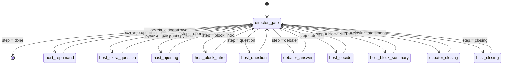

# Graf debaty

Diagram stanów UML przedstawia rzeczywiste węzły i krawędzie grafu LangGraph
z [`graph.py`](./graph.py). Po wykonaniu
każdego węzła graf wraca do `director_gate`; kolejny węzeł wybiera router na
podstawie stanu i oczekujących interwencji.

## Wybór kolejnego kroku

- `director_gate` obsługuje pauzę, zatrzymanie i komendy reżysera. Zatrzymanie
  ustawia fazę `stopped` i krok `done`. Notatki są zapisywane w stanie.
- Router najpierw kończy graf dla `done`, następnie obsługuje oczekujące
  upomnienia, a potem dodatkowe pytania. Dodatkowe pytanie może wejść przed
  zwykłym pytaniem, podsumowaniem bloku lub pierwszą mową końcową; nie przerywa
  wymiany odpowiedzi.
- `host_opening` przechodzi do `block_intro`, a `host_block_intro` do `question`.
  `host_question` rozpoczyna odpowiedzi debatantów (`debater`).
- `debater_answer` przechodzi do kolejnego
  debatanta albo do `decide`. Po dodatkowym pytaniu wraca do zapisanego kroku,
  bez zwiększania licznika zwykłych pytań w bloku.
- `host_decide` wybiera kolejne pytanie albo podsumowanie bloku. Przed osiągnięciem
  `questions_min` kontynuacja jest obowiązkowa; przy `questions_max` blok
  kończy się bez wywołania modelu decyzyjnego.
- `host_block_summary` przechodzi do następnego bloku albo, po ostatnim bloku,
  do włączonych mów końcowych, podsumowania prowadzącego lub końca. Po mowach
  końcowych następuje opcjonalne `host_closing`, a następnie koniec.
