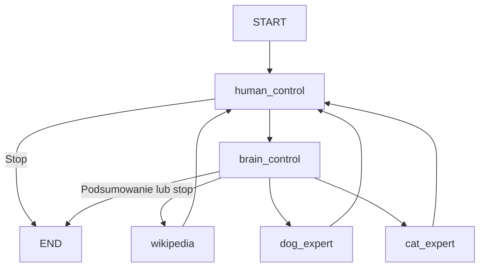

# Graf debaty

Kolejność ekspertów wybiera `brain_control`, biorąc pod uwagę niewiążącą sugestię przekazaną przez `human_control`. Kod ogranicza debatę do dwóch wypowiedzi każdego eksperta i najwyżej dwóch wyszukiwań między wypowiedziami. Po ostatniej wypowiedzi `brain_control` podsumowuje obie strony. Szczegóły opisuje [dokumentacja węzłów](expert_graph.md).