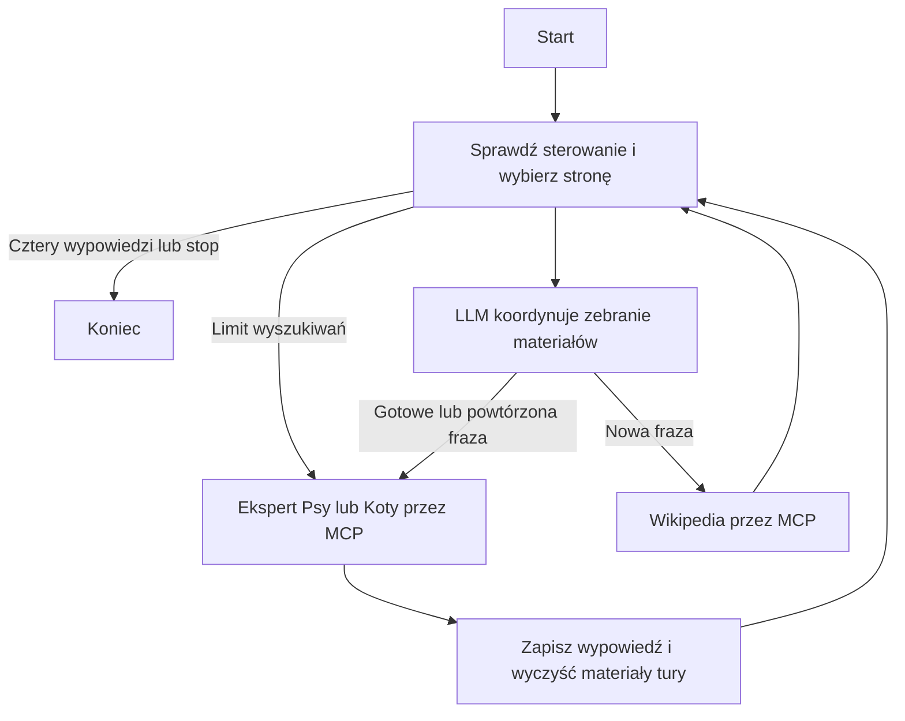

# Graf debaty

Kolejność i limit wyszukiwań wyznacza kod. Koordynator zwraca frazę lub `null`. Wikipedia zwraca fragmenty artykułów i adresy; brak wyników i błędy trafiają do kontekstu aktualnego eksperta jako notatka. Ekspert otrzymuje również pytanie i dotychczasowe publiczne wypowiedzi. Materiały badawcze nie przechodzą automatycznie na drugą stronę, ale źródła są widoczne w UI. Wypowiedź jest publikowana w całości.